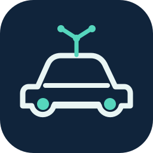

# 🚗 Automotive AI Skills (Habilidades de IA para Automoción)

Una colección de código abierto de **habilidades de IA para diagnóstico, mantenimiento, reparación, personalización y propiedad de vehículos** — tanto para principiantes como para mecánicos experimentados.

[English](./README.md) | [日本語](./README.ja.md) | **Español**

**¿Quieres colaborar?** [Busca una tarea para empezar](https://github.com/shoka-jp/automotive-ai-skills/contribute) o [comparte una pregunta o sugerencia](https://github.com/shoka-jp/automotive-ai-skills/issues/new?template=first-experience.yml). La publicación será un issue público en GitHub.

---

## Descripción general

Los modelos de lenguaje son genuinamente útiles en el taller — pero solo cuando se les consulta con estructura, contexto y conciencia de sus límites. Este repositorio empaqueta esa estructura como **habilidades**: marcos de prompts, flujos de trabajo y salvaguardas que convierten un asistente de IA de propósito general en un ayudante automotriz especializado.

Cada habilidad define:

- **Qué puede hacer** (capacidades, con limitaciones honestas)
- **Cómo usarla** (flujo de trabajo recomendado y contexto a proporcionar)
- **Prompts de ejemplo listos para usar**, que puedes copiar y adaptar

Las habilidades son **independientes de la plataforma**: funcionan con Claude, ChatGPT, modelos locales o cualquier asistente de IA capaz. No requieren instalación ni código.

## Habilidades (20)

Siete habilidades están **disponibles en español** — sigue los enlaces de la columna derecha.

| Habilidad | Qué hace | ES |
|---|---|---|
| 🔧 [Mechanic Assistant](./skills/mechanic-assistant/) | Procedimientos de reparación, pares de apriete, herramientas | [✔](./skills/mechanic-assistant/README.es.md) |
| 🔌 [OBD-II Diagnostic Assistant](./skills/obd2-diagnostic-assistant/) | Interpretación de códigos de falla, freeze frame y datos en vivo | [✔](./skills/obd2-diagnostic-assistant/README.es.md) |
| 📅 [Vehicle Maintenance Planner](./skills/vehicle-maintenance-planner/) | Planes de mantenimiento preventivo personalizados | [✔](./skills/vehicle-maintenance-planner/README.es.md) |
| 🔍 [Used Car Inspector](./skills/used-car-inspector/) | Listas de inspección precompra y apoyo en la negociación | [✔](./skills/used-car-inspector/README.es.md) |
| 🩺 [Vehicle Troubleshooting](./skills/vehicle-troubleshooting/) | Diagnóstico por síntomas: ruidos, fugas, vibraciones | [✔](./skills/vehicle-troubleshooting/README.es.md) |
| 🏁 [Vehicle Customization Advisor](./skills/vehicle-customization-advisor/) | Planificación de modificaciones, cálculos de compatibilidad | — |
| ⚡ [EV Assistant](./skills/ev-assistant/) | Carga, salud de la batería, autonomía, mantenimiento de VE | [✔](./skills/ev-assistant/README.es.md) |
| 🏍️ [Motorcycle Mechanic](./skills/motorcycle-mechanic/) | Mantenimiento de motocicletas, carburadores, válvulas | — |
| 🛢️ [Diesel Specialist](./skills/diesel-specialist/) | Common rail, DPF/EGR/SCR (AdBlue), calentadores | — |
| 🕰️ [Classic Car Restorer](./skills/classic-car-restorer/) | Encendido por platinos, carburadores, óxido, piezas descatalogadas | — |
| 🚛 [Fleet Manager](./skills/fleet-manager/) | Gestión de flotas: calendarios, costes, tiempo de inactividad | — |
| 🛞 [Tire & Wheel Advisor](./skills/tire-wheel-advisor/) | Cálculo de medidas, estrategia estacional, desgaste, TPMS | — |
| 🚚 [Commercial Vehicle & Truck Assistant](./skills/commercial-vehicle-assistant/) | Frenos neumáticos, inspección previa al viaje, sujeción de carga | — |
| 🎨 [Body & Paint Assistant](./skills/body-paint-assistant/) | Evaluación de golpes y arañazos, pintura, límites del bricolaje | — |
| 🪝 [Towing & Trailer Advisor](./skills/towing-trailer-advisor/) | Enganches, peso en punta, cableado y frenos de remolque | — |
| 🔊 [Car Audio & Electronics Assistant](./skills/car-audio-electronics/) | Radios, amplificadores, dash cams, disciplina de cableado 12V | — |
| 📝 [Service Intake Assistant](./skills/service-intake-assistant/) | Recepción de síntomas, registro de evidencias y comunicación con el taller | [✔](./skills/service-intake-assistant/README.es.md) |
| 🧾 [Repair Estimate Reviewer](./skills/repair-estimate-reviewer/) | Comparación del alcance, las evidencias y los cálculos de presupuestos de reparación | — |
| 🏷️ [Used Car Listing Assistant](./skills/used-car-listing-assistant/) | Anuncios de vehículos usados con datos documentados, estado y desglose de precio | — |
| 📣 [Vehicle Recall Checker](./skills/vehicle-recall-checker/) | Consultas oficiales de campañas, aplicabilidad al vehículo y pruebas de reparación | — |

## Uso

1. **Elige la habilidad** que corresponda a tu situación.
2. **Lee su flujo de trabajo recomendado** — cada habilidad indica qué contexto reunir (datos del vehículo, síntomas, mediciones).
3. **Copia un prompt de ejemplo** y adáptalo con los datos de tu vehículo. Puedes escribir en español: las habilidades definen la *estructura* de la conversación, no el idioma.
4. **Trabaja de forma iterativa.** Informa los resultados; los flujos están diseñados como conversaciones, no como preguntas únicas.
5. **Respeta la sección de limitaciones.** Verifica las especificaciones críticas de seguridad contra la documentación de fábrica y deriva los trabajos de alto riesgo a profesionales.

Para un asistente dedicado, pega el README de una habilidad en las instrucciones de un Proyecto de Claude o un GPT personalizado — ver [`integrations/`](./integrations/).

**Claude.ai y Claude Desktop:** cada [versión publicada](https://github.com/shoka-jp/automotive-ai-skills/releases/latest) desde la v1.5.0 incluye un ZIP por habilidad (por ejemplo `obd2-diagnostic-assistant.zip`) con sus instrucciones y sus guías en inglés, japonés y español. Descárgalo y súbelo en la configuración de Skills de Claude (**Settings → Capabilities**, o **Customize → Skills** en versiones recientes); las Skills necesitan la ejecución de código activada. También puedes generar todos los ZIP con `python scripts/package_skills.py`.

## Leer tu coche real: obd2-mcp 🔌

Estas habilidades son la capa de *conocimiento*. El proyecto hermano [**obd2-mcp**](https://github.com/shoka-jp/obd2-mcp) es la capa de *herramientas*: un servidor MCP que permite a la IA leer códigos de falla, datos en vivo y freeze frame de tu coche mediante un adaptador ELM327 económico. Incluye un vehículo simulado, así que puedes probarlo sin hardware.

**Claude Desktop:** descarga el archivo `.mcpb` de la [última versión de obd2-mcp](https://github.com/shoka-jp/obd2-mcp/releases/latest) y ábrelo. **Otros clientes MCP:** [elige cómo empezar](https://github.com/shoka-jp/obd2-mcp#choose-how-to-start): registra el paquete publicado con `npx` (sin Git) o compílalo desde el código fuente. Su prompt guiado `check_engine_light` combina bien con el [Asistente de diagnóstico OBD-II](./skills/obd2-diagnostic-assistant/README.es.md), y `used_car_check` con el [Inspector de coches usados](./skills/used-car-inspector/README.es.md).

**Con un coche real:** conecta el adaptador, pon el contacto y pide a Claude que se conecte; no hace falta saber el nombre del puerto. No todos los adaptadores funcionan en un ordenador (los que solo usan Bluetooth LE no), así que consulta antes [qué tipo comprar](https://github.com/shoka-jp/obd2-mcp/blob/main/docs/adapters.md) (en inglés y japonés).

La documentación de obd2-mcp está en inglés y japonés.

## Aviso de seguridad

Estas habilidades ofrecen información general, **no asesoramiento profesional**. Verifica siempre pares de apriete, capacidades y holguras contra el manual de fábrica. Frenos, dirección, airbags (SRS), sistemas de combustible y sistemas de alto voltaje de VE son territorio profesional en caso de duda. Consulta el [aviso completo](./docs/safety-disclaimer.md) (en inglés).

## Estado de la traducción

Siete habilidades ya están traducidas al español (ver la tabla); las demás están en **inglés y japonés**. Las traducciones al español de las habilidades restantes son bienvenidas — consulta [CONTRIBUTING.md](./CONTRIBUTING.md) y abre un issue para coordinar.

## Apoya el proyecto

Si estas habilidades te ayudan con tu coche o tu taller:

- [Sigue a shoka-jp](https://github.com/shoka-jp) para ver otros proyectos de IA para automoción.
- Marca este repositorio con una estrella para guardarlo, o comparte una habilidad con quien la necesite.
- Ayuda a mejorar los ejemplos, corregir errores o traducir habilidades con la [guía de contribución](./CONTRIBUTING.md) (en inglés).
- [Patrocina al mantenedor](https://github.com/sponsors/shoka-jp) para apoyar este trabajo de código abierto.

## Licencia

[MIT](https://github.com/shoka-jp/automotive-ai-skills/blob/main/LICENSE) © 2026 Sho Kamakura

> **Nota:** Esta traducción se basa en el README en inglés, que prevalece en caso de discrepancia.
